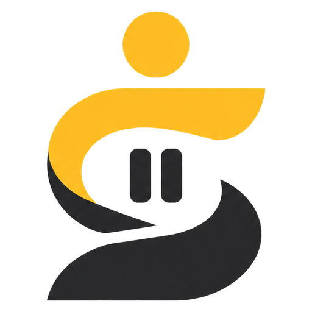

<p align="center"></p>

<h1 align="center">SEJENAK</h1>
<p align="center">Platform kebiasaan digital sehat untuk mahasiswa · PWA + Dok Sejenak (ESP32)</p>

SEJENAK membantu mahasiswa mengenali pola penggunaan media sosial, memberi jeda reflektif saat batas pribadi terlewati, menghubungkan dengan konselor sebaya (Teman Sejenak), dan merujuk ke BK kampus atas persetujuan. SEJENAK tidak mendiagnosis dan tidak menggantikan layanan profesional.

## Siklus empat langkah

1. **Cek Pola**: skrining 6 butir berbasis BSMAS dan catatan durasi manual per aplikasi.
2. **Rehat**: jeda napas 10 detik dan pertanyaan "Untuk apa kamu membuka ini?", dengan tombol tutup dan lanjut yang setara.
3. **Teman Sejenak**: obrolan terjadwal 30 menit dengan konselor sebaya di bawah supervisi dosen BK. Kata kunci krisis memunculkan kartu bantuan dan tidak diteruskan ke antrean sebaya.
4. **Rujuk dan Tinjau**: rujukan ke BK dengan pratinjau yang bisa diubah, dan tinjauan skor tiap 4 pekan.

**Dok Sejenak** (IoT) mencatat waktu ponsel diletakkan, membuka Rehat saat ponsel diangkat, menyalakan lampu napas, dan punya tombol bantuan fisik. Detail di [iot/README.md](iot/README.md).

## Struktur

```
app/        PWA React + Vite + TypeScript
iot/        Firmware ESP32, konfigurasi broker MQTT, simulator
docs/       Panduan penggunaan (PDF), mockup, tangkapan layar
media/      Video penjelasan alur kerja sistem
tools/      Skrip pembuat tangkapan layar, mockup, dan video
PRD_SEJENAK.md   Dokumen kebutuhan produk
PRODUCT.md       Ringkasan konteks desain
```

## Menjalankan aplikasi

```bash
cd app
npm install
npm run dev
```

Buka `http://localhost:5173`, lalu pilih **Mode demo uji coba** untuk masuk sebagai Mahasiswa, Teman Sejenak, Konselor BK, atau Admin kampus dengan data contoh. Tombol **Masuk dengan akun kampus** menjalankan alur pertama kali (persetujuan, skrining, hasil, batas pribadi).

Build produksi: `npm run build` (hasil di `app/dist`, sudah termasuk service worker untuk PWA luring).

## Desain

- Identitas dari logo: kuning `#FDBC22` dan arang `#2A2A2C`; warna modul dari PRD (teal Cek Pola, koral Rehat, violet Teman Sejenak, slate Rujuk) dipakai sebagai bidang, dengan varian tinta yang lolos kontras 4,5:1.
- Inter untuk antarmuka, Source Serif 4 untuk kalimat reflektif.
- Mode terang dan gelap, `prefers-reduced-motion` dihormati, target sentuh minimal 44 px.
- Tanpa merah alarm, tanpa streak, tanpa hitung mundur agresif.

## Catatan

Ini prototipe uji coba. Autentikasi SSO, backend, dan basis data masih disimulasikan di perangkat (localStorage). Nomor dan kanal BK kampus perlu diisi oleh admin sebelum pilot.

Penulis: Muhammad Yusuf Arrayyan, Universitas Bengkulu.
